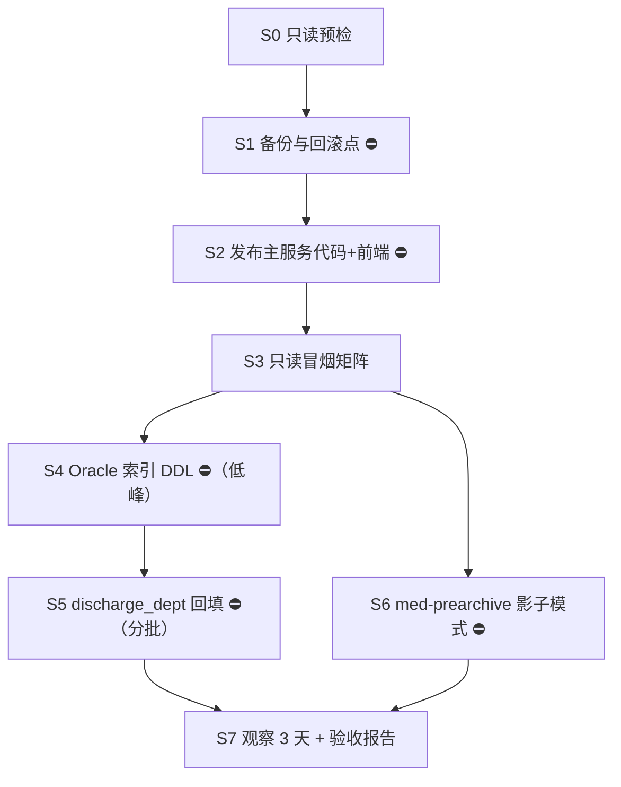

# 执行任务书 `PROMPT-WP10`：生产发布、增量 DDL 与影子模式启用（**分步审批执行**）

> **所属总计划**：`docs/ACTIVE/064_FULLSTACK_OPTIMIZATION_MASTER_PLAN_20261119.md`（工作包 10 / 10）  
> **预计耗时**：约 2.5~3 小时（不含用户审批等待）  
> **前置依赖**：`WP-09` 全仓 `--full` 门禁通过、交付报告已由用户确认  
> **授权方式**：本包每一个「⛔ 需批准」步骤，执行 AI 必须先把**完整命令/SQL + 影响面 + 回滚方法**发给用户，得到用户对**该步骤**的明确回复「同意执行」后才能执行；未获批准的步骤只准写到报告里。读完 `AGENTS.md`「Remote Production Server」与「Version Skew Guard」两节，以及 `prompts-064/PROMPT-00`。

---

## 一、发布顺序总览

---

## 二、步骤明细

### S0 只读预检（无需批准，只读）
1. 本地 `git status --short` 存档；生成本次发布文件清单（`app/` 改动文件 + `static/ui-next/` 构建产物 + 新脚本）。
2. 登录 `10.10.8.84:40022`（口令只从 `MED_AUDIT_SSH_PASSWORD` 读取）：`docker ps`、当前镜像 ID、`UI_DEFAULT_ENTRY`、写闸四值（`timeliness.jhemr_write.enabled`、`insert_monitor_enabled`、`notify_mode`、`JHEMR_INTEGRATION_ENABLED`）。
3. **版本撕裂比对**：对容器 `/app/app/` 与本地 `app/` 计算全部 `.py` 的 MD5，输出「仅本地有 / 仅容器有 / 两边不同」清单。若存在**不属于本计划改动**的差异（容器比本地新），立即停止并报告用户。
4. 确认 `config.json` 中不存在 `holography_360` 段时，新代码会用默认值（`S28/wfy`）——无需改配置。

### S1 备份与回滚点（⛔ 需批准）
- `docker commit med-audit med-audit:backup-pre-064-<YYYYMMDD>`；
- 宿主机备份：`/opt/med-audit-docker/{.env,docker-compose.yml}` 与容器内将被覆盖文件 tar 到 `/root/backup_pre_064_<YYYYMMDD>.tar.gz`；
- **严禁**触碰 `/app/config/config.json` 中的密文与 `.env` 的 `SECRET_KEY`。

### S2 发布主服务（⛔ 需批准）
- Windows 上传文件先放 ASCII 路径 `C:\Users\ADMINI~1\AppData\Local\Temp\opencode\`；
- `docker cp` 覆盖 `app/` 改动文件与 `static/ui-next/`，清理 `__pycache__`，`docker restart med-audit`；
- 启动后核对：容器 healthy、启动日志无异常栈、`init_db` 已自动补 `MED_PUSH_LOG.DISCHARGE_DEPT` 列（只读查询 `ALL_TAB_COLUMNS`）、写闸四值未变；
- 通过后 `docker commit -m "064 WP01-09" med-audit med-audit:latest` 固化。
- 回滚：`docker tag med-audit:backup-pre-064-<YYYYMMDD> med-audit:latest` + compose 重建，或 tar 回灌。

### S3 只读冒烟矩阵（无需批准，全部 GET 或 `dry_run`）
| 域 | 检查 | 通过标准 |
| --- | --- | --- |
| 总览 | `GET /api/stats/workbench-overview` 计时 | 首次 < 1.5s，缓存命中 < 200ms，5 个顶层块齐全 |
| 时效扫描 | 观察 2 轮 `MED_TL_SCAN_RUN` | 单轮耗时显著下降（目标 < 30s），`events_updated` 从 ~8,190 降到数百以内；日志有 `phase_ms` |
| 时效统计 | `GET /api/timeliness/stats/analytics` | 200，科室/医生排名有数据 |
| 月度考核 | `stats/monthly?date_from=…&date_to=…&page=1&limit=20`、`export/monthly?format=xlsx` | 200；xlsx 可打开；`MED_EXPORT_AUDIT_LOG` 新增一行 |
| 360 | `GET /api/config/holography`（admin 账号） | `sys_code=S28`、`user_code=wfy` |
| 权限 | 用一个 `timeliness_reader` 测试账号调用 stats/logs/patient-qc/relay-alert/timeliness | 只返回本科室数据；relay-alert retry 返回 403 |
| 内涵质控 | `/ui-next/#/quality/records` | 自动跳到 `quality/patients?view=records` |
| 规则中心 | `GET /api/audit-types` | 未开启 `jhemr_reminder_policy` 的规则行为不变 |
| JHEMR 提醒 | `GET /api/integrations/jhemr/ai-reminders` | 开关关闭返回 503 |
| 菜单 | admin 菜单含「时效统计分析」「归档前形式预检规则」，不再显示「AI 内涵质控记录」 | — |

### S4 Oracle 增量索引（⛔ 需批准，低峰期，如 12:30 或 18:00 后，避开 09:00/11:44 调度）
- 执行 `scripts/oracle_perf_indexes_20261119.sql` 中 3 条 `CREATE INDEX ... ONLINE`；每条前后记录耗时；
- 执行后对比 `/api/stats/severity`、`/api/stats/anomaly-top` 耗时（目标：841ms / 292ms 降到 200ms 以内）。
- 回滚：脚本内 `DROP INDEX` 语句。

### S5 `discharge_dept` 历史回填（⛔ 需批准，分批）
- 先 `python scripts/backfill_pushlog_discharge_dept_20261119.py --dry-run` 报告待回填行数；
- 批准后 `--apply --batch 2000 --limit 50000` 分多次执行，每次间隔观察数据库负载；
- 完成标准：`DISCHARGE_DEPT IS NULL` 的行数降到可接受值（报告列出无法解析的剩余行数）。

### S6 `med-prearchive` 影子模式（⛔ 需批准）
按 `docs/reference/123_PREARCHIVE_SHADOW_AND_PAPERLESS_PUSH_RUNBOOK_20261119.md` 执行：
1. 备份 `/app/config/prearchive.prod.json` 与镜像 tag；
2. 由**用户本人**在宿主机设置预检服务所需的密码环境变量（执行 AI 不得索要或转发明文）；
3. 替换为影子模板（`anchor_mode=discharge`、只开 jhemr/his/sm、所有投递开关 false）；
4. `import_rules_cli.py` 先 dry-run 再 `--apply`（只写 `MED_PREARCHIVE_RULE*` 表）；
5. 重启 `med-prearchive`，观察 2 个轮询周期：日志不再出现 `[poll] fetch failed`，`MED_PREARCHIVE_*` 运行/问题表开始有数据，**Outbox/投递日志 0 条外发**；
6. 病案室页面 `/governance/workbench` 能看到检查结果。
- 回滚：恢复原配置文件 + 重启。

### S7 观察与验收报告
- 连续观察 3 个工作日：调度任务（09:00、11:44）成功、时效扫描耗时、总览响应时间、预检影子结果数与病案室标注情况；
- 产出 `review/064-wp10/RELEASE_REPORT.md`：每步执行时间、命令输出摘要、镜像 ID、回滚点、冒烟结果、遗留问题（如 CDMS 只读账号、无纸化推送接口厂商对接、JHEMR 提醒路线 B 客户端对接）；
- 登记 `开发起步包/01_统一修改记录.md`（生产写入行必须写明每步的授权来源与回滚点）与 `02`，更新 064 总计划与 INDEX 状态。

---

## 三、红线
1. 未获该步明确批准不执行任何 ⛔ 步骤；177 / 216 业务库只读，本包对 216 仅执行 S4/S5 批准范围内的应用库（`JHEMR.MED_*`）DDL/DML。
2. 不改写闸：`jhemr_write.enabled=False`、`insert_monitor_enabled=False`、`notify_mode=LOG_ONLY`、`JHEMR_INTEGRATION_ENABLED=false` 全程保持。
3. 不触碰密文与 `SECRET_KEY`；日志与报告零明文口令、零患者姓名。
4. 禁止 Git commit/push（除非用户另行明确指令）。
